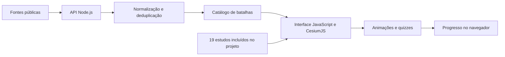

<div align="center">

# ⚓ Atlas Naval

### História naval em um globo 3D interativo

Explore batalhas, acompanhe animações táticas e revise o conteúdo com quizzes.

[](#tecnologias) [](#como-funciona) [](#executar-localmente)

[Abrir aplicação](https://carta-de-combate-naval.vercel.app) · [Riachuelo](https://carta-de-combate-naval.vercel.app/#b-riachuelo) · [Normandia](https://carta-de-combate-naval.vercel.app/#b-normandia)

</div>

## Sobre o projeto

O **Atlas Naval** é uma aplicação web em português para estudar história naval por meio da localização geográfica, do contexto histórico e da evolução tática dos combates. Foi concebido para apoiar o estudo de Fuzileiros Navais e também pode ser explorado por estudantes e interessados em história militar.

A experiência combina um catálogo de batalhas reunido de fontes públicas com **19 estudos completos** incluídos no código. Cada estudo reúne uma ficha histórica, animação por fases, lições, o papel dos fuzileiros e perguntas de revisão. A interface se adapta ao computador e ao celular.

## Funcionalidades

| Recurso | O que permite fazer |
| :--- | :--- |
| **Globo 3D** | Navegar pelos locais das batalhas, aproximar o mapa e consultar imagens de satélite da Esri. |
| **Busca e filtros** | Buscar por batalha, guerra ou ano; filtrar por Brasil, operações anfíbias, estudos completos e época. |
| **Animação tática** | Acompanhar fases do combate, pausar, avançar, voltar e alterar a velocidade. |
| **Estudo guiado** | Alternar entre Ficha, Fases, Lições, Fuzileiros e Quiz. |
| **Quizzes e treino** | Revisar com perguntas dos estudos e questões geradas a partir do catálogo carregado. |
| **Progresso local** | Guardar resultados de quizzes no navegador com `localStorage`. |
| **Links diretos** | Compartilhar um estudo por URL, como `/#b-riachuelo`. |

### Batalhas com estudo completo

Salamina · Lepanto · Gravelines (Armada Invencível) · Trafalgar · Combate de 4 de Maio · Juncal · Passo de Tonelero · Riachuelo · Passagem de Humaitá · Tsushima · Galípoli · Jutlândia · Midway · Afundamento do U-199 · Normandia · Golfo de Leyte · Iwo Jima · Inchon · San Carlos.

## Como usar

1. Explore os pontos do globo ou a lista lateral.
2. Use a busca e os filtros para encontrar um período ou combate.
3. Escolha uma batalha marcada como **Estudo** para abrir a animação e o material de revisão.
4. Explore as abas do estudo e responda ao **Quiz**.
5. Use **Treino** para praticar com novas perguntas.

## Tecnologias

- **HTML5 e CSS3:** interface responsiva, painéis e controles.
- **JavaScript:** estado, filtros, animações, quizzes e persistência local; sem framework de interface.
- **CesiumJS 1.139.1:** globo, câmera, marcadores, camadas e movimentos táticos.
- **Node.js e funções da Vercel:** coleta e consolidação das fontes.
- **SheetJS (`xlsx`):** leitura da planilha NAVBATTLE.
- **Wikidata/SPARQL e APIs da Wikipedia:** metadados e enriquecimento do catálogo.

## Como funciona



O navegador solicita o catálogo à função `/api/batalhas`. Ela consulta as fontes, reúne registros, remove duplicatas e complementa informações como coordenadas e nomes. O total exibido depende das fontes disponíveis e do resultado da coleta.

A API configura cache de CDN por 24 horas e mantém um cache em memória por até seis horas, enquanto a instância estiver ativa. O navegador guarda o catálogo por até dois dias. Se a API não responder, a interface tenta consultar a Wikidata diretamente. Os 19 estudos completos continuam incluídos no projeto mesmo se a lista geral não carregar.

| Rota | Retorno |
| :--- | :--- |
| `GET /api/batalhas` | Catálogo com `geradoEm`, `total` e `items`. |
| `GET /api/batalhas?debug=1` | Diagnóstico com contagens, tempos, erros por fonte e amostra dos registros. |

## Executar localmente

Requisitos: Node.js com suporte a `fetch` global, npm, navegador com WebGL e conexão com a internet para carregar CesiumJS, mapas e fontes externas.

```bash
git clone https://github.com/matosluan93/atlas-naval.git
cd atlas-naval
npm install
npx vercel dev
```

Acesse o endereço informado pela CLI, normalmente `http://localhost:3000`. Na primeira execução, a Vercel pode solicitar login e vinculação do projeto.

A aplicação não exige compilação do front-end. Abrir apenas `index.html` não executa a função Node.js; nesse modo, a interface tenta obter a lista geral diretamente da Wikidata.

### Terreno 3D opcional

O globo funciona sem token do Cesium ion. Para ativar o relevo, configure em `config.js` um token adequado para uso no navegador:

```js
window.APP_CONFIG = { cesiumIonToken: "SEU_TOKEN" };
```

Esse arquivo é entregue ao navegador, portanto o token fica visível no cliente. Use restrições apropriadas de domínio e permissões e mantenha credenciais privadas fora do repositório.

## Publicar na Vercel

1. Importe este repositório como um novo projeto.
2. Selecione o preset **Other** e mantenha a raiz como diretório de origem.
3. Não configure comando de build; mantenha `npm install` para instalar a dependência da API.
4. Publique e valide o globo e `/api/batalhas`.

O arquivo `vercel.json` solicita duração máxima de 300 segundos para a coleta, sujeita aos limites do ambiente de hospedagem. Hospedagem apenas estática, como GitHub Pages, não executa essa função.

## Estrutura

```text
atlas-naval/
├── index.html             # Página principal e carregamento do CesiumJS
├── styles.css             # Interface responsiva
├── app.js                 # Globo, filtros, animações, estudos e quizzes
├── config.js              # Configuração opcional do Cesium ion
├── data/
│   ├── curadas.js         # Estudos e integração das duas partes
│   └── curadas-extra.js   # Estudos adicionais
├── api/
│   ├── batalhas.js        # Coleta, enriquecimento e deduplicação
│   ├── _navbattle.js      # Tratamento da planilha NAVBATTLE
│   ├── _acw.json          # Guerra Civil Americana
│   └── _marea.json        # Combates pós-1945
├── package.json           # Dependência da função serverless
└── vercel.json            # Duração da função
```

## Fontes e atribuições

O coletor utiliza as fontes abaixo, identificadas também nos registros retornados pela API:

- **Wikidata:** dados estruturados em CC0.
- **Wikipedia — List of naval battles:** lista e artigos associados; conteúdo sob CC BY-SA.
- **The War Atlas:** catálogo geográfico identificado no código como CC BY 4.0.
- **NAVBATTLE — Harvard Dataverse:** [doi:10.7910/DVN/HGZGCY](https://doi.org/10.7910/DVN/HGZGCY).
- **American Civil War Battle Data:** [jrnold/acw_battle_data](https://github.com/jrnold/acw_battle_data).
- **MAREA Scale Models:** registro de batalhas navais pós-1945.

Imagens do mapa: Esri, Maxar e Earthstar Geographics, com créditos exibidos na aplicação. Cada fonte mantém seus próprios termos e atribuições; esses termos não constituem uma licença única para o código.

## Observações sobre os dados

A quantidade de batalhas e a completude das fichas variam conforme a disponibilidade das fontes. Forças, perdas e resultados podem divergir entre registros históricos. As animações representam uma sequência didática dos combates.

O progresso fica apenas no navegador utilizado, sem conta de usuário ou sincronização entre dispositivos.

---

Projeto de [Luan Felipe de Matos Santos](https://github.com/matosluan93).
